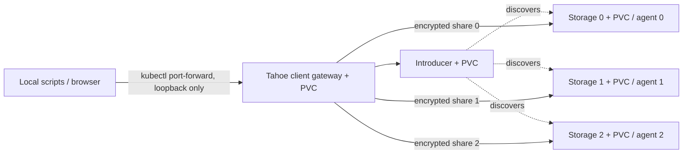

# p2p-drive

A local Tahoe-LAFS proof of concept for open-source, decentralized file storage.
This phase validates encrypted storage and recovery; it does not implement a
custom P2P engine, user accounts, or a file management UI.

## Architecture



Share numbers are illustrative; Tahoe chooses their placement. The client
encrypts and erasure-codes files before sending shares to storage providers.
`shares.needed = 2`, `shares.total = 3`, and `shares.happy = 3` require three
distinct servers for a successful immutable upload and allow recovery from any
two. Approximate storage overhead is 1.5× plus metadata. Tiny files may use
literal capabilities instead of storage shares; the integration test uses random
2 MiB immutable CHK files to exercise real erasure coding.

The Helm chart creates five single-replica StatefulSets with separate `local-path`
PVCs. Each PVC retains the complete node directory: configuration, private
identity, introducer cache, and (for storage nodes) shares. Stable pod DNS names
are advertised using `tub.location`, and port 3457 is fixed using `tub.port`.
Each storage StatefulSet selects a different k3d agent hostname. The introducer
helps nodes discover servers; it does not hold file content or encryption keys.

## Prerequisites

- Ubuntu/WSL2 with Docker Desktop integration enabled
- Docker, k3d, kubectl, Helm 3, Python 3, and Bash
- Existing `p2p-drive` k3d cluster and `k3d-p2p-drive` kubectl context
- Three agent nodes named `k3d-p2p-drive-agent-{0,1,2}` and `local-path` storage
- Internet access for the initial image build; no registry is needed after import

All commands below run from this repository's root (the directory with
`AGENTS.md`). Scripts explicitly select the Kubernetes context. Optional
environment overrides are `KUBE_CONTEXT`, `CLUSTER`, `NAMESPACE`, `RELEASE`, and
`IMAGE`. Defaults are `k3d-p2p-drive`, `p2p-drive`, `p2p-drive`, `tahoe`, and
`p2p-drive/tahoe-lafs:1.20.0-poc`. Agent hostnames and PVC size/class are chart
values; change `charts/tahoe-lafs/values.yaml` before deploying elsewhere.

## Build and deploy

```bash
./scripts/build.sh
./scripts/deploy.sh
```

The image pins Tahoe-LAFS to **1.20.0** and Python's base image by digest. Native
dependencies compile in a separate build stage. Runtime processes run as UID
10001 with no elevated capabilities or Kubernetes API token.

Deployment first starts the introducer, copies its generated FURL directly into
the `tahoe-introducer` Kubernetes Secret without printing it, and then enables
the rest of the grid. No generated identity or capability is stored in Helm
values or committed to Git. Subsequent deploys keep the existing grid enabled.
Pods may take a short time to discover one another; deployment waits for all
three storage connections, not just pod readiness.

## Upload and download

The scripts start a temporary loopback-only port-forward automatically:

```bash
mkdir -p .local
printf 'hello from p2p-drive\n' > .local/input.txt
./scripts/upload.sh .local/input.txt .local/example.cap
./scripts/download.sh .local/example.cap .local/output.txt
sha256sum .local/input.txt .local/output.txt
```

The capability file is created exclusively with private permissions. Choose a
new path for every upload. A capability is a bearer credential containing the
authority to decrypt a file: retain it securely, do not paste it into logs or
issues, and do not commit it. Losing the capability can make your file
unrecoverable even if every share remains available. `.local/` and `*.cap` are
ignored by Git. Demo scripts buffer files in memory and are intended for small
local test files.

For the private web API / Tahoe UI:

```bash
./scripts/port-forward.sh
# Open http://127.0.0.1:3456 locally. Ctrl-C ends the forward.
```

There is no Ingress, NodePort, LoadBalancer, or Service exposing port 3456.
The API binds to `127.0.0.1` **inside the client pod**. A NetworkPolicy admits
only intra-release grid traffic on port 3457. Do not change the API bind address
or port-forward address to `0.0.0.0`. Anyone with permission to exec into pods
or port-forward the client is inside the trust boundary and may access plaintext
and capabilities. The gateway sees plaintext; the storage servers receive
encrypted shares. This setup is for a trusted local cluster, not hostile tenants.
Kubernetes Secrets require appropriate RBAC and encryption-at-rest configuration
for production; base64 encoding alone is not encryption.

## Verify recovery

```bash
./scripts/test-recovery.sh
```

The integration test:

1. Checks that all three storage pods occupy distinct non-control-plane nodes
   and that the client API is inaccessible from a storage pod.
2. Uploads fresh random data, checks Tahoe's reported 2-of-3 encoding, and asserts
   that its share map has exactly one different share on each of three servers.
3. Downloads with all servers available and verifies SHA-256.
4. Scales one storage StatefulSet to zero and waits until the pod is gone and
   only two storage servers are connected. It never deletes the PVC.
5. Restarts the client to discard any in-memory download state, verifies exactly
   two available shares, and downloads again, checking SHA-256.
6. Restores the StatefulSet in a `finally` block and verifies the same PVC,
   volume, private identity hash, and original share are retained.
7. Repeats the outage for each of the three storage servers.

Keep the client and cluster running during the test. A process kill or terminal
loss can interrupt cleanup; restore with `kubectl --context k3d-p2p-drive -n
p2p-drive scale statefulset tahoe-storage-0 tahoe-storage-1 tahoe-storage-2
--replicas=1`. The test never repairs or reuploads data during an outage.

Static checks:

```bash
helm lint charts/tahoe-lafs
helm template tahoe charts/tahoe-lafs --set gridEnabled=true > /tmp/tahoe.yaml
for script in scripts/*.sh; do bash -n "$script"; done
python3 -m py_compile docker/entrypoint.py scripts/*.py
git diff --check
```

## Operations and limitations

- `kubectl --context k3d-p2p-drive -n p2p-drive get pods,pvc -o wide` shows state.
  Treat pod logs and node directories as sensitive; do not publish them wholesale.
- `helm uninstall tahoe --kube-context k3d-p2p-drive -n p2p-drive` stops workloads;
  StatefulSet PVCs and the manually created introducer Secret remain. Reinstall
  using the same release/namespace to reuse identities and shares. Do not delete
  the namespace, cluster, or PVCs if you need that data.
- `local-path` volumes belong to individual k3d nodes. The recovery test models
  a storage-process outage. All nodes share one Docker host: host loss, Docker
  disk loss, or cluster deletion can lose everything. This is not a backup.
- Two servers are sufficient for reads, but new uploads require all three due
  to `shares.happy = 3`. There is no automated repair, capacity marketplace,
  authentication layer, public peer discovery, or multi-host durability yet.
- The introducer and client are single instances. Their PVCs preserve identity,
  but no high-availability control plane is provided.
- Tahoe itself is pinned; transitive dependencies are resolved at build time.
  This is not yet a fully reproducible supply-chain build.
- Use a new `IMAGE` tag when changing the container so Helm rolls out the new
  image. Rebuilding and importing an existing tag does not restart running pods.
- Docker Compose is deferred to keep Phase 1 focused on the tested Kubernetes
  deployment and per-agent placement.

Configuration and API syntax are based on the selected upstream release:
[configuration.rst](https://github.com/tahoe-lafs/tahoe-lafs/blob/tahoe-lafs-1.20.0/docs/configuration.rst),
[webapi.rst](https://github.com/tahoe-lafs/tahoe-lafs/blob/tahoe-lafs-1.20.0/docs/frontends/webapi.rst).
